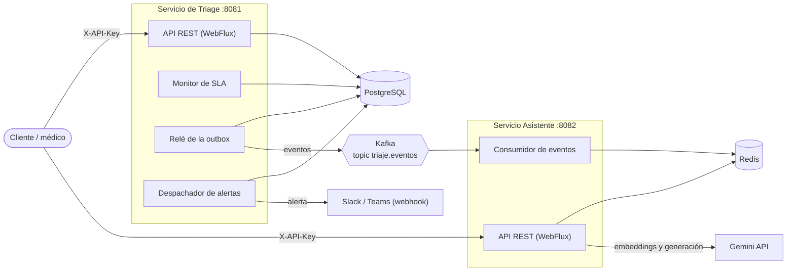

# VidaCruz: triaje digital con asistente clínico

Sistema backend (APIs y eventos) para el triaje de urgencias de VidaCruz: clasifica a los pacientes con reglas clínicas
objetivas, vigila los tiempos de atención (SLA), escala automáticamente a quien los supera y ofrece a los médicos un
asistente de consulta de protocolos con IA que **solo responde con lo que dicen los protocolos y cita la fuente**.

Está formado por dos microservicios en Java reactivo (Spring Boot, WebFlux y Reactor) que se comunican únicamente por Kafka.

| Repositorio | Contenido |
|---|---|
| `vidacruz-platform` (este) | `docker-compose.yml`, manifests de Kubernetes, ADR, contrato de eventos |
| [`vidacruz-triage-service`](https://github.com/<usuario>/vidacruz-triage-service) | Registro, clasificación, estados, SLA, escalamiento, reporte y alertas |
| [`vidacruz-assistant-service`](https://github.com/<usuario>/vidacruz-assistant-service) | Asistente clínico con RAG y vista de urgencias |

## Ejecutar todo con un solo comando

Requisitos: Docker (con Compose v2) y los tres repositorios clonados **uno junto al otro**:

```
carpeta/
├─ vidacruz-platform/            <- aquí se ejecuta el comando
├─ vidacruz-triage-service/
└─ vidacruz-assistant-service/
```

> Si tus carpetas se llaman distinto (o solo tienes este repositorio), define `TRIAGE_CONTEXT` y `ASSISTANT_CONTEXT` en el
> `.env` con la ruta o la URL de GitHub de cada servicio (ver `.env.example`).

**Windows (PowerShell):**

```powershell
.\run.ps1
```

**Linux y macOS:**

```bash
./run.sh
```

El script crea el archivo `.env` con **secretos aleatorios** (si no existe; nunca sobrescribe lo que ya hayas puesto),
construye las imágenes, levanta PostgreSQL, Kafka, Redis y los dos servicios, y espera a que respondan. La primera vez
tarda varios minutos. Al terminar:

| Servicio | URL |
|---|---|
| Triaje | http://localhost:8081 |
| Asistente | http://localhost:8082 |

- **Las API keys** están en `.env` (`TRIAGE_SECURITY_APIKEYS` y `ASSISTANT_SECURITY_APIKEYS`) y se envían en la cabecera `X-API-Key`.
- **El asistente clínico necesita una key de Gemini** (gratuita en Google AI Studio): ponla en `.env` como `GEMINI_API_KEY`
  (o expórtala antes de ejecutar el script). Sin ella, el servicio arranca y responde `503` a las consultas clínicas (modo
  degradado); el resto, incluida la vista de urgencias, funciona igual.
- `docker compose down` detiene todo y conserva los datos; `docker compose down -v` los borra.

## Probarlo en un minuto

Con las claves de `.env` (PowerShell, desde `vidacruz-platform`):

```powershell
function Get-EnvValue($name) { ((Get-Content .env | Where-Object { $_ -like "$name=*" }) -split "=", 2)[1] }
$t = @{ "X-API-Key" = (Get-EnvValue "TRIAGE_SECURITY_APIKEYS") }
$a = @{ "X-API-Key" = (Get-EnvValue "ASSISTANT_SECURITY_APIKEYS") }

# 1. Registrar un paciente crítico (caso E1 del enunciado)
$body = '{"fullName":"Juan Perez","age":40,"heartRate":130,"systolicBp":180,"diastolicBp":110,"spo2":97,"temperature":36.8,"pain":8,"gcs":15,"chiefComplaint":"Dolor toracico"}'
$p = Invoke-RestMethod -Method Post -Uri http://localhost:8081/triage/pacientes -Headers $t -ContentType "application/json" -Body $body
$p      # id, nivel CRITICO, slaMinutos 5, estado REGISTRADO, fechaRegistro

# 2. Pasarlo a consulta y consultarlo
Invoke-RestMethod -Method Patch -Uri "http://localhost:8081/triage/pacientes/$($p.id)/estado" -Headers $t -ContentType "application/json" -Body '{"estado":"EN_CONSULTA"}'
Invoke-RestMethod -Uri "http://localhost:8081/triage/pacientes/$($p.id)" -Headers $t

# 3. La vista de urgencias del asistente se construye solo con eventos de Kafka (sin llamar al triaje)
Invoke-RestMethod -Uri http://localhost:8082/asistente/estado-urgencias -Headers $a

# 4. Consultar los protocolos (con cita) y una pregunta sin protocolo
$q = @{ pregunta = "¿Cuáles son las medidas iniciales ante una crisis hipertensiva?" } | ConvertTo-Json
Invoke-RestMethod -Method Post -Uri http://localhost:8082/asistente/consulta -Headers $a -ContentType "application/json; charset=utf-8" -Body ([Text.Encoding]::UTF8.GetBytes($q))
```

Con `curl` (Linux y macOS):

```bash
TRIAGE_KEY=$(grep '^TRIAGE_SECURITY_APIKEYS=' .env | cut -d= -f2)
curl -s -X POST http://localhost:8081/triage/pacientes -H "X-API-Key: $TRIAGE_KEY" -H "Content-Type: application/json" \
  -d '{"fullName":"Juan Perez","age":40,"heartRate":130,"systolicBp":180,"diastolicBp":110,"spo2":97,"temperature":36.8,"pain":8,"gcs":15,"chiefComplaint":"Dolor toracico"}'
```

**Ver el escalamiento sin esperar 5 minutos:** añade `TRIAGE_SLA_CRITICO: "1"` y `TRIAGE_SLAMONITOR_INTERVAL: "2s"` en el
bloque `environment` del servicio `triage-service` de `docker-compose.yml`, ejecuta de nuevo el script y registra un
paciente crítico. Al minuto queda escalado (`escalado: true` en `GET /triage/pacientes/{id}`) y aparece en el log del
triaje la línea `ESCALATION ALERT`. Para recibir la alerta en Slack o Teams, define `TRIAGE_ALERTS_WEBHOOK_URL` en `.env`.

## Arquitectura



**Principios de diseño**

- **El triaje nunca depende del asistente.** Solo se comunican por Kafka; el triaje funciona con el asistente caído (y con Kafka
  caído, porque los eventos esperan en la *outbox*).
- **Arquitectura hexagonal** en ambos servicios: `domain` (modelo, casos de uso y puertos, sin Spring) e `infraestructure`
  (adaptadores, configuración y puntos de entrada). Las dependencias apuntan siempre hacia el dominio.
- **Programación reactiva de extremo a extremo** (WebFlux, R2DBC, reactor-kafka, Lettuce reactivo). Las pocas llamadas
  bloqueantes que impone una librería (el cliente de Gemini, la lectura del corpus al arrancar) se aíslan en un planificador aparte.
- **Consistencia entre base de datos y Kafka** con una *outbox transaccional*: el evento se guarda en la misma transacción que
  el cambio, y un relé lo publica en orden y con reintentos (entrega al menos una vez; los consumidores son idempotentes).

**Tecnologías:** Java 21, Spring Boot (3.3 en el triaje, 3.5 en el asistente), WebFlux y Reactor, R2DBC con PostgreSQL 16 y
Flyway, Kafka en modo KRaft (reactor-kafka), Redis 7, Spring AI con Gemini (`gemini-embedding-001` y un modelo de chat
configurable), Resilience4j, Micrometer con Prometheus y puente OpenTelemetry, Testcontainers, Docker y Kubernetes.

Todas las decisiones están razonadas en los [ADR](docs/adr/README.md); el formato de los mensajes de Kafka, en el
[contrato de eventos](docs/events/triaje-eventos.md).

## Requisitos funcionales

| Requisito | Cómo se cumple |
|---|---|
| RF-01 Registro y clasificación | `POST /triage/pacientes`: valida los rangos (400 con el campo inválido), clasifica con RN-01 y publica `paciente_registrado` |
| RF-02 Estados | `PATCH /triage/pacientes/{id}/estado` (409 si la transición no es válida o hubo un cambio concurrente) y `GET /triage/pacientes/{id}` con el flag `escalado` y el tiempo en el estado actual |
| RF-03 SLA y escalamiento | Monitor periódico que escala con una actualización condicional en la base de datos; intervalo y SLA configurables |
| RF-04 Asistente | `POST /asistente/consulta` (RAG con citas, sin alucinaciones, 503 en modo degradado) y `GET /asistente/estado-urgencias` (vista en Redis alimentada solo por eventos) |
| RF-05 Reporte | `GET /triage/reportes/operacion?desde&hasta`: una sola consulta SQL con CTE, `ROW_NUMBER() OVER`, `COUNT ... FILTER` y `PERCENTILE_CONT` |
| RF-06 Alertas | Cola durable en PostgreSQL y despachador con reintentos hacia un webhook ([ADR 0007](docs/adr/0007-escalation-alerts-webhook-with-durable-queue.md)) |

**Reglas de negocio:** RN-01 en `TriageClassifier` (con los casos E1-E6 y todos los valores límite como tests); RN-02 en
`SlaPolicy`; RN-03 con una actualización condicional (`WHERE status = 'REGISTRADO' AND escalated = FALSE`) que lo garantiza la
base de datos, aun con varias réplicas; RN-04 en la tabla `patient_audit` (no existe ningún endpoint de borrado); RN-05 con dos
barreras: sin fragmentos relevantes no se consulta al modelo, y toda respuesta se valida contra el corpus antes de devolverse.

### Referencia rápida de la API

| Método y ruta | Descripción |
|---|---|
| `POST /triage/pacientes` | Registra y clasifica (201) |
| `PATCH /triage/pacientes/{id}/estado` | Cambia el estado (200, 404, 409) |
| `GET /triage/pacientes/{id}` | Detalle del paciente (200, 404) |
| `GET /triage/reportes/operacion?desde=...&hasta=...` | Reporte por hora, fechas ISO 8601 (200, 400) |
| `POST /asistente/consulta` | Consulta RAG: `{"pregunta": "..."}` devuelve `{"respuesta", "fuentes": [{"protocolo", "seccion"}]}` (200, 400, 503) |
| `GET /asistente/estado-urgencias` | Activos por nivel (200, 503) |
| `GET /actuator/health/liveness` y `/readiness` | Probes, **públicos** |
| `GET /actuator/metrics` y `/actuator/prometheus` | Métricas, protegidas con la API key |

Todo lo demás exige `X-API-Key`. Los errores tienen siempre la forma `{timestamp, status, code, message, violations?}`.

## Supuestos y decisiones de interpretación

El enunciado deja huecos; estos son los supuestos asumidos (los de mayor impacto):

1. **Quejas administrativas (nivel 5):** coincidencia exacta con la lista, ignorando mayúsculas, tildes y espacios (`"vacunación infantil"` no cuenta).
2. **"Superó su SLA"** significa estrictamente después del plazo. El SLA se guarda en cada paciente al registrarlo: cambiar la configuración no altera a los ya registrados.
3. **Reporte de operación:** rango `[desde, hasta)` en UTC, máximo 31 días; se agrupa por la hora de **registro**; solo se listan las horas con pacientes;
   quienes nunca entraron a consulta cuentan en los totales pero no en el promedio ni en el p95 (el campo `atendidos` indica sobre cuántos se calculó);
   el tiempo de espera es hasta la **primera** entrada a consulta; el p95 usa interpolación continua.
4. **"No existe protocolo disponible"** responde `200` con ese aviso y `fuentes` vacío: es una respuesta válida del asistente, no un error. Un fallo técnico
   (Gemini caído, circuito abierto) es `503`.
5. **Alertas (RF-06):** webhook HTTP con un mensaje que solo lleva el id del paciente, el nivel, el SLA y la espera (sin datos personales ni clínicos).
   Nunca se descartan: se reintentan con espera exponencial (máximo 5 min). Sin URL configurada, la alerta va al log.
6. **Contrato de la API:** los campos de entrada están en inglés (`fullName`, `heartRate`...), y las respuestas usan los nombres del enunciado
   (`nivel`, `slaMinutos`, `estado`, `fechaRegistro`).
7. **Vista de urgencias:** eventualmente consistente (un retraso de segundos). Si se pierde el evento de alta de un paciente, queda contado como activo hasta que se reconstruya la vista
   (se reconstruye vaciando Redis y reiniciando el grupo de consumo, ver [ADR 0006](docs/adr/0006-urgency-view-as-event-projection.md)).
8. **Umbral de relevancia del RAG** (0,65), calibrado con mediciones reales de Gemini: las preguntas con protocolo puntuaron 0,72 o más y las que no, 0,59 o menos. Hay que recalibrarlo si cambia el modelo de embeddings.

## Seguridad

- **API key** por servicio en `X-API-Key` ([ADR 0008](docs/adr/0008-api-key-authentication.md)): seguro por defecto (sin una clave de 16 o más caracteres el servicio **no arranca**), con rotación sin cortes
  (varias claves separadas por comas), comparación sin filtrar información por tiempos y un `401` que no revela si la clave falta o es incorrecta.
- **Ninguna credencial en el código ni en el repositorio:** claves, contraseñas y la URL del webhook entran por variables de entorno; el `.env` está en `.gitignore`.
- **Contenedores sin privilegios** (usuario no root), sin capacidades de Linux en Kubernetes y con cierre ordenado.
- **Sin datos personales en logs ni alertas;** en el asistente nunca se escribe el texto de las preguntas. Entradas validadas con Bean Validation.
- La pregunta del médico se trata como dato: el prompt ignora instrucciones que intenten cambiar las reglas, y aun así toda respuesta pasa la validación de citas.

## Resiliencia y observabilidad

- **Modo degradado:** circuit breaker de Resilience4j y tiempo máximo sobre Gemini ([ADR 0005](docs/adr/0005-degraded-mode-circuit-breaker.md)); con el circuito abierto responde `503` al instante y sin tocar al proveedor.
- **Probes:** `liveness` solo del estado interno; `readiness` del triaje depende de PostgreSQL (no de Kafka); la del asistente no depende de Redis, Kafka ni Gemini, porque degrada en lugar de salir de servicio.
- **Métricas** (Prometheus): clasificaciones y escalamientos por nivel, alertas y eventos pendientes, latencia del LLM y de la búsqueda, consultas por resultado y estado del circuit breaker.
- **Logs:** texto legible en local y JSON con el perfil `json` (el que usan los contenedores), con `traceId` por petición ([ADR 0009](docs/adr/0009-observability.md)).

## Pruebas

En cada servicio (requieren Docker para Testcontainers, con PostgreSQL, Kafka y Redis reales):

```bash
./gradlew test          # unitarias e integración; el LLM está simulado
./gradlew geminiTest    # solo en el asistente: contra Gemini real, necesita GEMINI_API_KEY
```

Cubren la clasificación de E1-E6 y todos los valores límite, las transiciones válidas e inválidas, la idempotencia y la concurrencia del escalamiento,
el reporte con datos conocidos, las citas del RAG y el caso "sin coincidencia sin alucinación", la cola de alertas con un canal que falla y se recupera,
y el flujo de eventos con duplicados, desorden y mensajes corruptos.

## Despliegue

- **Local:** Docker Compose (arriba).
- **Kubernetes:** en [`k8s/`](k8s) hay manifests para AKS (Namespace, StatefulSet de PostgreSQL y Kafka, Redis, un Deployment por servicio con los probes de arriba, Services y un Job que crea el topic),
  con los secretos fuera del repositorio ([ADR 0010](docs/adr/0010-aks-deployment-with-in-cluster-state.md)). Se aplican con `kubectl apply -k k8s` después de crear el Secret `vidacruz-secrets` a partir del `.env`
  (`kubectl create secret generic vidacruz-secrets -n vidacruz --from-env-file=.env`).
- **Estado en Azure:** **no se ha podido desplegar en Azure.** No fue posible crear una suscripción: el alta devuelve *"You're not eligible for an Azure free account"* con varias cuentas y tarjetas,
  y la solicitud a soporte de Azure sigue pendiente. Los manifests y el procedimiento están listos para aplicarse en cuanto exista la suscripción.

## Verificado en Kubernetes local

Los manifests de `k8s/` se desplegaron y probaron en el Kubernetes integrado de Docker Desktop (un solo nodo). No es AKS, pero es un clúster
real y es lo más cercano que se pudo ejecutar sin suscripción de Azure. Se usaron las imágenes de los Dockerfiles, un Secret creado a partir del
`.env` y `kubectl apply -k k8s`:

| Comprobación | Resultado |
|---|---|
| Arranque | Los 6 pods (`postgres-0`, `kafka-0`, `redis`, `triage-service`, `assistant-service` y el Job `kafka-init`) en `Running` o `Completed`, sin reinicios |
| Probes y autenticación | `readiness` de ambos servicios en `UP`; sin API key, `401 UNAUTHORIZED` |
| Eventos por Kafka dentro del clúster | La vista de urgencias del asistente pasa de 0 a `CRITICO: 1` tras registrar un paciente crítico en el triaje |
| El triaje no depende del asistente | Con el asistente a 0 réplicas el triaje sigue registrando (`201`); al volver a arrancar, la vista incluye al paciente registrado mientras estaba caído, porque el consumidor retoma desde su último offset confirmado |

Dos problemas propios de Kubernetes, que Docker Compose no tenía, aparecieron y se corrigieron (detalle en el [ADR 0010](docs/adr/0010-aks-deployment-with-in-cluster-state.md)):
Kubernetes inyecta variables de entorno por cada Service (por ejemplo `REDIS_PORT=tcp://...`) que chocaban con las del asistente (se desactivó con `enableServiceLinks: false`),
y los Job no admiten cambios en su plantilla (hay que borrarlos y recrearlos).
## Limitaciones conocidas y evolución

- Un solo nodo y una réplica por servicio; el diseño ya tolera varias (escalamiento, alertas y vista idempotentes), pero no se ha probado a escala.
- Sin TLS en los manifests (requiere un dominio y un certificado): en producción, una puerta de entrada con certificado.
- PostgreSQL, Kafka y Redis van dentro del clúster; en producción serían servicios administrados (Kafka exigiría añadir SASL y TLS al cliente).
- El `traceId` no viaja en los mensajes de Kafka: seguir un caso entre servicios se hace por el id del paciente. Evolución: propagar el contexto de la traza y exportar a un colector.
- Vector store en memoria: el corpus se vuelve a calcular en cada arranque; con un corpus mayor habría que persistirlo.